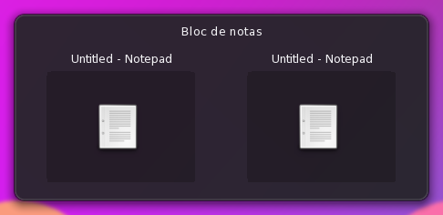
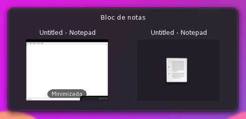
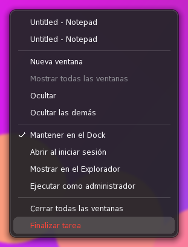
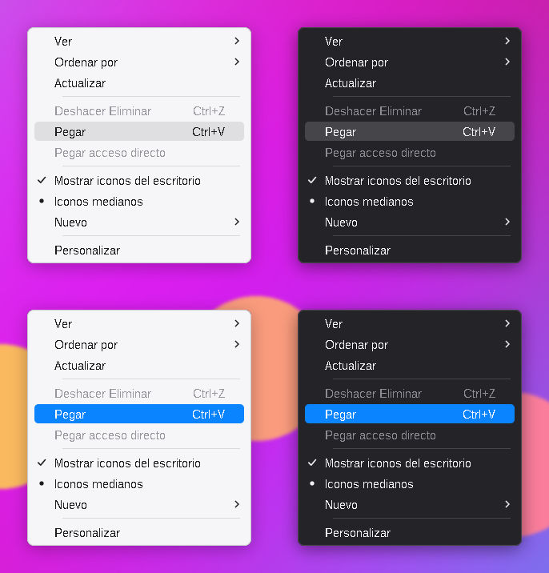

# Dock estilo Apple para Windhawk

Mod de [Windhawk](https://windhawk.net) que reemplaza la barra de tareas de
Windows 11 por un Dock como el de macOS, abajo de la pantalla principal.

## Qué hace

- **Ampliación fluida**: cada cuadro se sincroniza con el refresco real del
  monitor (60, 120, 144 Hz). Los iconos se dibujan con precisión de subpíxel.
- **Apps ancladas y abiertas**: toma las apps ancladas a la barra de Windows,
  incluidas las de la Tienda (Configuración, Calculadora…). Las abiertas sin
  anclar aparecen a la derecha, con su indicador.
- **Vista de ventanas** al pasar el mouse sobre una app abierta: miniaturas en
  vivo y, para las ventanas minimizadas, una foto de cómo se veían.
- **Menú propio con clic derecho**: ventanas de la app, Nueva ventana, Ocultar,
  Ocultar las demás, Mantener en el Dock, Abrir al iniciar sesión, Mostrar en
  el Explorador, Ejecutar como administrador, Salir y **Finalizar tarea**.
  Funciona aunque otra app esté en primer plano.
- **Arrastrar** para ordenar, hacia arriba o a la papelera para quitar.
- **Soltar archivos**: en la papelera (la de Windows, con deshacer), en una app
  para abrirlos con ella, o anclar un `.exe`/acceso directo entre los iconos.
- **Inicio** con el logo de Windows del sistema y **Papelera de reciclaje**.
- **Se esconde** con ventanas maximizadas o en pantalla completa; aparece al
  llevar el mouse al borde de abajo, ocupando solo su espacio.
- Rueda del mouse sobre una app para pasar entre ventanas o minimizar.
- **Tope de cuadros por segundo** opcional (60, 30 o 60 solo con batería)
  para ahorrar batería en monitores de alta frecuencia.

| Vista de ventanas | Ventana minimizada | Menú |
|---|---|---|
|  |  |  |

> Las capturas salen del banco de pruebas en Wine, donde los iconos son los
> genéricos de Wine y no hay miniaturas en vivo. En Windows se ven los iconos
> y las ventanas reales.

## Instalación

1. Instala [Windhawk](https://windhawk.net).
2. *Crear un mod nuevo*, pega el contenido de
   [`dock-estilo-apple.wh.cpp`](dock-estilo-apple.wh.cpp) y compílalo.
3. Ajusta la configuración del mod a tu gusto.

Hace pareja con el mod **Muesca superior estilo Apple** (barra de menús,
reloj y bandeja arriba) y con **Menús estilo Apple** (abajo), que está en
este mismo repositorio.

## Configuración

Tamaño y separación de los iconos, ampliación (tamaño y alcance), estilo del
fondo (cristal líquido, translúcido, oscuro o claro), opacidad, redondeo,
distancia al borde, cuándo esconderse y con qué retardos, ocultar la barra de
tareas, Inicio (con icono propio opcional), papelera (de Windows o
vectorial), indicador de app abierta, nombres, sombras, vista de ventanas
(miniaturas, lista o nada), clic central (otra ventana, minimizar, cerrar),
clic en Inicio (menú Inicio, todas las aplicaciones o búsqueda), rueda del
mouse, bloquear el orden, rebotes, velocidad de las animaciones y cuadros por
segundo.

## Cómo está hecho

- Una ventana por capas que nunca toma el foco, del tamaño del Dock.
- El ritmo de cuadros sale de `D3DKMTWaitForVerticalBlankEvent` (con
  `DwmFlush` y un temporizador de alta resolución como respaldo).
- Rasterizador propio en enteros para iconos y fondo; GDI+ solo para texto.
- Hilos aparte para leer las ventanas abiertas, cargar iconos, preparar el
  cristal y tomar las fotos de las ventanas.
- El menú y la vista de ventanas son ventanas propias con ganchos de bajo
  nivel solo mientras están abiertos.
- Poco trabajo en segundo plano: el listado de ventanas valida cada proceso
  una vez por recorrido; la barra de tareas se busca por su clase; solo se
  escuchan los eventos del sistema que se usan; las fotos de ventanas se
  toman solo con la vista en miniaturas, nunca con un juego en pantalla
  completa, y se reducen con un promedio de área separable.

## Menús estilo Apple

Segundo mod, [`menu-estilo-apple.wh.cpp`](menu-estilo-apple.wh.cpp): cambia
el estilo de los menús del clic derecho y de los menús desplegables en el
escritorio, el Explorador y las aplicaciones, con los mismos colores que el
menú del Dock.

- Fondo liso claro u oscuro (según el tema de cada menú), sin la franja de
  los iconos.
- Resaltado en pastilla redondeada, gris neutro o con el color de acento.
- Palomita, punto de opción y flecha de submenú vectoriales, con antialias.
- Separadores finos, esquinas más redondeadas y un borde fino (DWM).
- Opción para que el escritorio y el Explorador usen el menú clásico
  completo: el menú nuevo de Windows 11 no se puede restilar. Puede hacer
  falta reiniciar el Explorador la primera vez; al desactivar el mod vuelve
  el de Windows 11.

Se instala igual que el Dock (*Crear un mod nuevo* y pegar el archivo). Se
engancha a las funciones de dibujo de temas de Windows (`uxtheme`), así que
no cambia los menús que las apps dibujan por su cuenta (Chrome, Firefox,
Office, apps de la Tienda).

> La captura sale del banco de pruebas: los menús se dibujan con el código
> del mod, pero las esquinas, el borde y la sombra (que en Windows pone DWM)
> están simulados en la imagen.

## Herramientas

- `herramientas/compilar/compilar.sh`: compila el mod igual que Windhawk
  (clang + mingw-w64 vía `pip install ziglang`) para revisar errores y
  advertencias fuera de Windhawk. Con `SRC=../../menu-estilo-apple.wh.cpp`
  compila el de los menús.
- `herramientas/pruebas/`: banco de pruebas que carga el mod sin cambios en
  Wine, con una barra de tareas simulada, y recorre los escenarios con el
  mouse simulado (101 comprobaciones: clics, arrastres, menú, vista de
  ventanas, Finalizar tarea, esconderse, 120 fps, tope de 60…). `menus.sh`
  hace lo mismo con el mod de los menús (qué temas son de menú, el menú
  clásico del Explorador) y dibuja menús de muestra; `menus_png.py` los pasa
  a PNG.

## Limitaciones

- Las insignias de número y las barras de progreso de la barra de tareas no
  se muestran.
- Solo en el monitor principal.
- Ocultar la barra de tareas la pone en "ocultar automáticamente"; al
  desactivar el mod vuelve como estaba.
