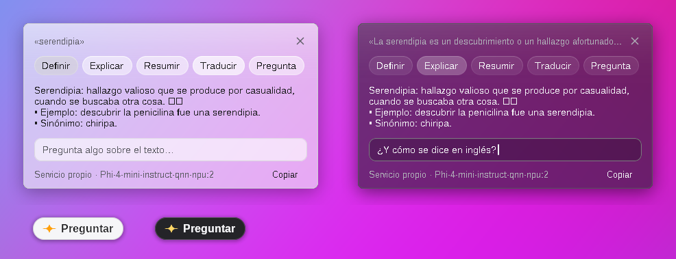

# Consulta rápida al seleccionar

Mod de [Windhawk](https://windhawk.net), independiente de los demás, que hace
en **cualquier app** algo parecido a Click to Do de Copilot: seleccionas
texto (en el navegador, Word, el Bloc de notas, un PDF, un chat, la
terminal…), aparece un botón **Preguntar** y la respuesta sale ahí mismo, en
una ventanita, sin abrir Copilot ni cambiar de ventana.



> La captura sale del banco de pruebas, con un servidor falso; el
> desenfoque de lo de atrás, las esquinas, el borde y la sombra (que en
> Windows pone DWM) están simulados.

## Qué hace

- Al seleccionar texto en una página (arrastrando o con doble clic) aparece
  **Preguntar** junto al mouse unos segundos. También sirve un atajo
  (Ctrl+Mayús+Espacio de fábrica).
- La ventanita **no genera nada hasta que eliges** qué hacer: **Definir**,
  **Explicar**, **Resumir**, **Traducir** o **Pregunta** (responde la
  pregunta seleccionada), o escribes tu propia pregunta abajo (Enter).
  Mientras eliges, el modelo se prepara en segundo plano, así que responde
  enseguida. Si prefieres que empiece solo, en **Al tocar Preguntar** está
  el modo automático: define de una a tres palabras, responde si es una
  pregunta («¿…?» o «…?») y explica un texto más largo.
- **Foundry Local se enciende y se apaga solo.** Si está apagado (después de
  reiniciar el equipo o de cerrarlo), al abrir la ventanita el mod lo
  arranca en segundo plano, sin ventanas (`foundry server start`), espera a
  que responda y carga el modelo (el último que usaste, o uno de NPU
  descargado). Abajo dice en qué va: "Iniciando Foundry Local", "Cargando el
  modelo". Tras un rato **sin consultas** (10 minutos de fábrica; 5, 30, 60
  o nunca) lo detiene (`foundry server stop`, y si no responde, cierra sus
  procesos): la NPU y la memoria quedan libres. El mod también libera su
  ventanita; mientras tanto solo quedan sus ganchos del mouse y el teclado,
  que no gastan nada mientras no los uses.
- **Cristal (liquid glass).** Fondo translúcido sobre lo de atrás
  desenfocado (lo hace Windows), con un reflejo arriba y un borde brillante,
  más fuerte arriba, como el cristal de Apple; los botones y la caja, de
  cristal también. Si Windows tiene apagados los *efectos de transparencia*,
  o con la opción del mod apagada, queda opaca.
- **Animaciones a 120 cuadros por segundo** (o a la frecuencia de la
  pantalla, si es mayor): la ventanita aparece subiendo y desvaneciéndose,
  crece con suavidad mientras llega la respuesta, los botones se iluminan
  al pasar el mouse, los puntos de "pensando" laten, y se va desvaneciendo.
  El botón **Preguntar** también aparece y se va suavemente. Usa un
  temporizador de alta resolución con plazos fijos, y solo mientras algo se
  mueve: quieta, no dibuja nada. Con *Mostrar animaciones* apagado en
  Windows, todo cambia al instante.
- **Cambiar de botón mientras responde** no da "ocupado": al cortar una
  respuesta, Foundry Local sigue generándola unos segundos (la NPU atiende de
  a una) y rechaza la nueva. El mod lo nota, muestra "Esperando a que el
  modelo termine la respuesta anterior" y la pide de nuevo en cuanto se
  libera (hasta un minuto y medio). Las respuestas ya terminadas se guardan
  mientras la ventanita sigue abierta: volver a ese botón las muestra al
  instante, sin preguntar otra vez, y tocar el botón que ya se ve no repite
  la consulta.
- La respuesta llega palabra por palabra. **Copiar** la copia; Esc o un clic
  fuera cierra la ventanita.
- **Intocable**: el botón y la ventanita nunca toman el foco, así que la app
  en uso sigue en primer plano y no se pierde la selección. Al tocar la caja
  de la pregunta, el mod lee el teclado él mismo (con tu distribución,
  mayúsculas, AltGr y acentos; Ctrl+V pega, Ctrl+Retroceso borra una palabra)
  y las teclas no llegan a la página, hasta Enter, Esc o un clic fuera. La
  rueda del mouse encima desplaza la respuesta, no la página.
- **Siempre encima** de todo mientras se ven, incluso de otras ventanas
  "siempre visibles" (se vuelven a poner arriba cada cuarto de segundo).
- **En todas las apps.** El mod corre una sola vez, dentro del Explorador de
  Windows (`explorer.exe`, el proceso del escritorio y la barra de tareas),
  y sus ganchos del mouse y del teclado ven todas las apps. El botón aparece
  al soltar una selección hecha arrastrando o con doble clic **empezando con
  el cursor de texto** (o en el contenido de una página web), así que no
  sale al mover ventanas, elegir archivos ni en el escritorio o la barra de
  tareas. El atajo funciona en cualquier app.
- En **Dónde funciona** se puede dejar solo en los navegadores (Chrome,
  Edge, Firefox, Brave, Opera, Vivaldi, Arc, Zen), y en **Excepto en**
  excluir programas (`code.exe, WindowsTerminal.exe`; el `.exe` es opcional).
- En las consolas (Terminal, símbolo del sistema, PuTTY, mintty) copia con
  Ctrl+Insert en vez de Ctrl+C, para no interrumpir lo que esté corriendo.
- No funciona en apps abiertas **como administrador**: Windows no deja que
  una app normal (el Explorador) vea su teclado ni copie de ellas.

## Con qué responde

| Opción | Dónde corre | Cómo prepararlo |
|---|---|---|
| **Foundry Local** (de fábrica) | En tu equipo, en la **NPU** de un PC Copilot+ (o en la GPU/CPU) | `winget install Microsoft.FoundryLocal` y `foundry run phi-4-mini` |
| Ollama | En tu equipo (GPU/CPU) | `ollama run llama3.2` |
| Otro servicio | Cualquiera compatible con la API de OpenAI, local o en la nube | Dirección, modelo y clave en la configuración |

Con Foundry Local el mod encuentra solo la dirección del servicio (cambia en
cada arranque) mirando en qué puerto escucha su proceso, sin correr comandos
(lanzado desde otro programa, `foundry …` puede quedarse colgado). Si no
está en marcha, lo arranca en segundo plano sin esperar a su comando (que
puede no terminar nunca) y lo busca otra vez por su puerto, hasta un minuto
y medio. Funciona con la versión actual de Foundry Local (`foundry
server …`) y con la anterior (`foundry service …`).

### Si dice que Foundry Local no está en marcha

En una terminal (PowerShell):

```
foundry server status        # ¿está corriendo? muestra su dirección
foundry server start         # si no, arráncalo
foundry run phi-4-mini       # descarga y carga un modelo (la primera vez tarda)
foundry model list           # qué modelos hay (los "npu" usan la NPU)
```

En la versión anterior los comandos eran `foundry service status` y
`foundry service start`. Si `foundry` no se reconoce, no está instalado
(`winget install Microsoft.FoundryLocal`) o hay que abrir una terminal nueva.
Si se instaló hace un momento y el mod no lo encuentra, reinicia el Explorador
(o cierra sesión y vuelve a entrar) para que tome el PATH nuevo.

La API de Foundry ofrece todo su catálogo (también modelos que no tienes
descargados), pero solo responde con los **cargados**. El mod le pregunta a
la API con un pedido mínimo cuál responde (a uno sin cargar le contesta con
un error al instante) y usa ese. Si no hay ninguno cargado, busca uno
descargado (`foundry model list --cached`) y lo carga solo ("Cargando el
modelo…"). La ventanita dice en qué paso está.
Nunca elige uno sin descargar. Entre los de NPU prefiere los rápidos (Phi)
antes que los de razonamiento (DeepSeek-R1, que piensa mucho antes de
contestar). Para usar uno en particular, pon su nombre en **Modelo** (los
nombres salen en `foundry model list --cached`).

Si aun así falla, copia la dirección que muestra `foundry server status`
(por ejemplo `http://127.0.0.1:5273`) en **Dirección del servicio**, en la
configuración del mod. Para que no cambie de puerto:
`foundry server restart --port 5273 --idle-timeout 0`. En *Registros* del
mod, en Windhawk, aparece lo que respondió Foundry. Con los
locales, el texto no sale de tu equipo; con un servicio en la nube, el texto
seleccionado se envía a ese servicio.

**¿Por qué no el mismo modelo de Click to Do?** Click to Do usa Phi Silica,
que Windows solo deja usar a apps empaquetadas con un permiso especial de
Microsoft. Un mod no puede pedirlo; Foundry Local es la forma abierta de usar
la NPU.

## Configuración

Servicio, dirección, modelo y clave; botón al seleccionar (sí/no); dónde
funciona (todas las apps o solo navegadores) y apps excluidas; atajo
(Ctrl+Mayús+Espacio, Ctrl+Alt+Espacio, Alt+Q o ninguno); qué hacer al tocar
Preguntar (esperar a que elijas, automático, definir, explicar o responder);
cuándo apagar Foundry Local sin uso (5, 10, 30, 60 minutos o nunca); idioma
de las respuestas; idioma al que traducir; largo máximo de la respuesta;
cómo leer la selección; efecto de cristal (sí/no); tema de la ventanita.

## Cómo lee la selección

De fábrica la **copia** (como Ctrl+C) solo cuando tocas Preguntar o el atajo,
y después devuelve el portapapeles como estaba (texto, imágenes, archivos;
los formatos raros de algunas apps pueden perderse). La alternativa es
**Accesibilidad de Windows** (UI Automation), que no toca el portapapeles
pero hace que Chrome y Edge activen su modo de accesibilidad, que gasta algo
más; si no consigue el texto, lo copia.

## Pruebas

`pruebas/correr.sh` levanta un servidor falso compatible con OpenAI
(`servidor_falso.py`, con respuestas por partes, razonamiento `<think>`,
acentos y emojis), compila `prueba.cpp` (que incluye el mod tal cual) y lo
corre en Wine, con un `foundry.exe` falso que imita la versión nueva y la
vieja, y un servidor que, como Foundry, ofrece todo el catálogo pero solo
responde con modelos cargados (y listas con nombres, solo alias o vacías),
un `foundrylocald.exe` falso con los comandos de Foundry colgados (que
también hace de servicio que `foundry server start` deja corriendo y
`foundry server stop` detiene), y un
"navegador" en primer plano para comprobar que la ventanita no le quita el
foco, que lo tecleado va a la caja y no a la página, y que vuelve a quedar
encima si otra ventana la tapa. Como la NPU, el servidor falso atiende de a
una respuesta y contesta 503 "busy" mientras sigue generando otra, aunque se
haya cortado: 79 comprobaciones (JSON, respuestas por partes, elección del
modelo de NPU, arrancar Foundry apagado en segundo plano, detenerlo sin uso
y volver a arrancarlo, que al tocar Preguntar no genere nada y prepare el
modelo mientras tanto, el fondo translúcido del cristal con el texto
nítido, que anime a 120 cuadros por segundo y que el hilo vuelva a dormir,
modelo de NPU, que funcione en cualquier app y no en el escritorio, la barra
de tareas ni las apps excluidas, que el botón salga solo al seleccionar con
el cursor de texto, Ctrl+Insert en las consolas, la dirección de Foundry Local en sus dos versiones, la ventanita y sus botones, responder una
pregunta seleccionada, cambiar de botón a media respuesta sin quedar en
"ocupado", volver al instante a una respuesta ya hecha, la pregunta propia, errores claros, leer la selección y devolver el
portapapeles, que no queden hilos al desactivarlo). `pruebas/a_png.py` pasa
las imágenes a PNG. Para compilarlo como Windhawk:
`SRC=../../consulta-rapida/consulta-rapida.wh.cpp sh herramientas/compilar/compilar.sh`.

No se pudo probar en Windows con apps ni con Foundry Local de verdad (el banco
corre en Linux con Wine).
