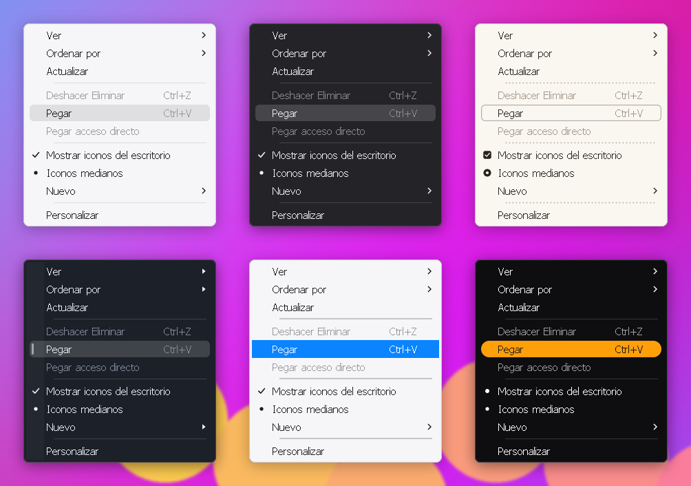

# Menús estilo Apple para Windhawk

Mod de [Windhawk](https://windhawk.net), independiente del Dock, que cambia el
estilo de los menús del clic derecho y de los menús desplegables (Archivo,
Edición…) en el escritorio, el Explorador y las aplicaciones, para que se vean
como los de macOS.

> La captura sale del banco de pruebas: los menús se dibujan con el código del
> mod, pero las esquinas, el borde y la sombra (que en Windows pone DWM) están
> simulados en la imagen.

## Qué hace

- Fondo liso claro u oscuro, según el tema de cada menú (o siempre uno de
  los dos), sin la franja de los iconos a la izquierda (se puede dejar).
- La opción bajo el mouse se marca en **gris claro** (de fábrica), con el
  color de acento de Windows o con un color propio.
- Opciones desactivadas tenues y sin resaltar; atajos de teclado (Ctrl+C…) en
  gris, como en macOS.
- Palomitas, puntos y flechas vectoriales, con antialias a cualquier escala.
- Esquinas redondeadas y borde fino (DWM).

En la captura, de izquierda a derecha y de arriba abajo: Grafito claro y
oscuro (de fábrica, gris claro en pastilla); Arena con contorno, casillas y
separadores de puntos; Hielo oscuro con barra lateral, triángulos y la franja
de iconos; acento de Windows en renglón completo con separadores gruesos; Alto
contraste con un naranja propio muy redondeado y puntos.

## Instalación

1. En Windhawk: *Crear un mod nuevo*, pega el contenido de
   [`menu-estilo-apple.wh.cpp`](menu-estilo-apple.wh.cpp) y compílalo.
2. **Reinicia el Explorador una vez**: Administrador de tareas → Procesos →
   Explorador de Windows → Reiniciar (o cierra sesión y vuelve a entrar).

El paso 2 hace falta para el escritorio y las carpetas: el menú nuevo de
Windows 11 (el de iconos arriba) no es un menú clásico y no se puede restilar.
Con la opción **Menú clásico en el escritorio y el Explorador** (activada de
fábrica) el Explorador usa el menú completo de siempre, que sí toma el estilo,
pero Windows solo lo lee al arrancar el Explorador.

Para volver al menú de Windows 11, apaga esa opción y reinicia el Explorador
antes de quitar el mod.

## Configuración

**Estética**

| Opción | Valores |
|---|---|
| Tema del menú | Automático, siempre claro, siempre oscuro |
| Paleta | Grafito (la del Dock), Arena, Hielo, Alto contraste |
| Fondos propios | Un color para el tema claro y otro para el oscuro (`#RRGGBB`) |
| Color del resaltado | Gris claro, acento de Windows o propio |
| Intensidad del resaltado | 10 a 300 % |
| Forma del resaltado | Pastilla, contorno, barra lateral, renglón completo |
| Redondeo y separación | En píxeles a escala de 100 % |
| Separadores | Línea fina, línea gruesa, puntos, solo espacio |
| Opciones marcadas | Palomita, punto, casilla |
| Flecha de submenú | Fina, triángulo, ninguna |
| Atajos en gris | Sí / no |
| Franja de los iconos | Mostrarla o no |
| Esquinas y borde | Redondeadas, poco o rectas; borde y su color |
| Barra de menús | Resaltar también Archivo, Edición… |

**Funciones**

| Opción | Qué hace |
|---|---|
| Animación al abrir | La del sistema, desvanecer, deslizar o ninguna |
| Retraso de los submenús | Milisegundos antes de abrirse (-1 = el del sistema) |
| Letras de acceso | Subrayarlas siempre, sin pulsar Alt |
| Apps excluidas | Programas donde los menús quedan como estaban (`chrome.exe; code.exe`) |
| Menú clásico | Escritorio y Explorador con el menú completo, que toma el estilo |

La animación, el retraso y las letras de acceso son ajustes de todo Windows:
los aplica el Explorador mientras el mod está activo, sin guardarlos en tu
perfil, y vuelven como estaban al desactivar el mod o la opción. Las apps
excluidas se toman en cuenta al volver a abrir la app.

## Si un menú no cambia

- Con el tema forzado a claro u oscuro, si en alguna app el texto no se lee,
  vuelve a Automático o excluye esa app.
- Las apps que dibujan sus propios menús no cambian: Chrome, Firefox, Office,
  Visual Studio Code, las apps de la Tienda y el Bloc de notas nuevo.
- En *Registros* del mod, en Windhawk, cada proceso escribe "Menús estilo Apple
  listo" al cargar y "Primer menú con estilo" la primera vez que pinta uno. Si
  en un proceso aparece lo primero pero no lo segundo después de abrir un
  menú, ese menú no pasa por los temas de Windows.

## Cómo está hecho

Se engancha a las funciones de dibujo de temas de Windows (`uxtheme`:
`DrawThemeBackground`, `DrawThemeTextEx` y compañía). Para saber si lo que se
pinta es un menú le pregunta a uxtheme la clase del tema (`GetThemeClass`), así
reconoce también los menús de procesos que ya estaban abiertos. Las formas se
dibujan con su propio rasterizador con antialias y se mezclan sobre el menú;
las esquinas y el borde los pone DWM.

## Pruebas

`pruebas/menus.sh` compila `menu_muestra.cpp` (que incluye el mod tal cual) y
lo corre en Wine: comprueba la lógica (qué temas son de menú, el menú clásico
del Explorador) y dibuja menús de muestra; `pruebas/menus_png.py` los pasa a
PNG. Para compilarlo como Windhawk:
`SRC=../../menu-estilo-apple/menu-estilo-apple.wh.cpp sh herramientas/compilar/compilar.sh`.
